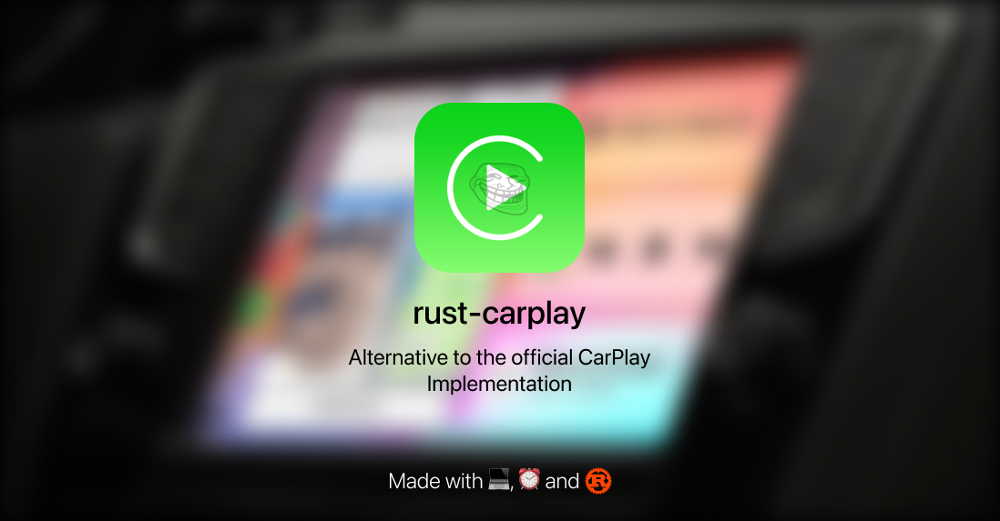

<div align="center">

[](https://github.com/tr1fled/rust-carplay)
</div>

## Welcome

Welcome to the rust-carplay code, there is not much to say other than congrats for getting access, and enjoy

## Running

### Running in linux:
I previously ran into an issue, turns out that Debian Bookworm (12) ships with GTK 4.8.3, which is not compatible with the gst-gtk4 crate used for the gtk4 sink, if you do not wish to use this sink, you shall remove the dependencies from Cargo.toml and rewrite `screen.rs` to interface with another sink. But, assuming you have a supported GTK version (the compilation will fail if otherwise): 
1. Install Rust
2. Clone this repo
3. Run it!
```bash
RUST_LOG=info cargo run
```

## Words from me

I am a beginner rust programmer, I tried to make it look somewhat simple, my solutions for problems might be garbage, so if you can give me a hand with that, please do! And a guilty confession, as much as I hate to say it, I did use ChatGPT for some of the code, because frankly, I know nothing about some concepts of rust and the inner workings of carplay. 

I hope I never have to use GPT again for coding...

## Liability
This is a snippet which barely works, it takes a loooot of work to get running, but it's a basic skeleton, development had begun about a year ago, and was paused around 6 months ago. Development has begun on a way more stable version of this called longplay, hopefully in full rust.

## Credits
* [hbouhadji](https://github.com/hbouhadji) for helping with steering me towards the right path, also for the MFi bypass 
